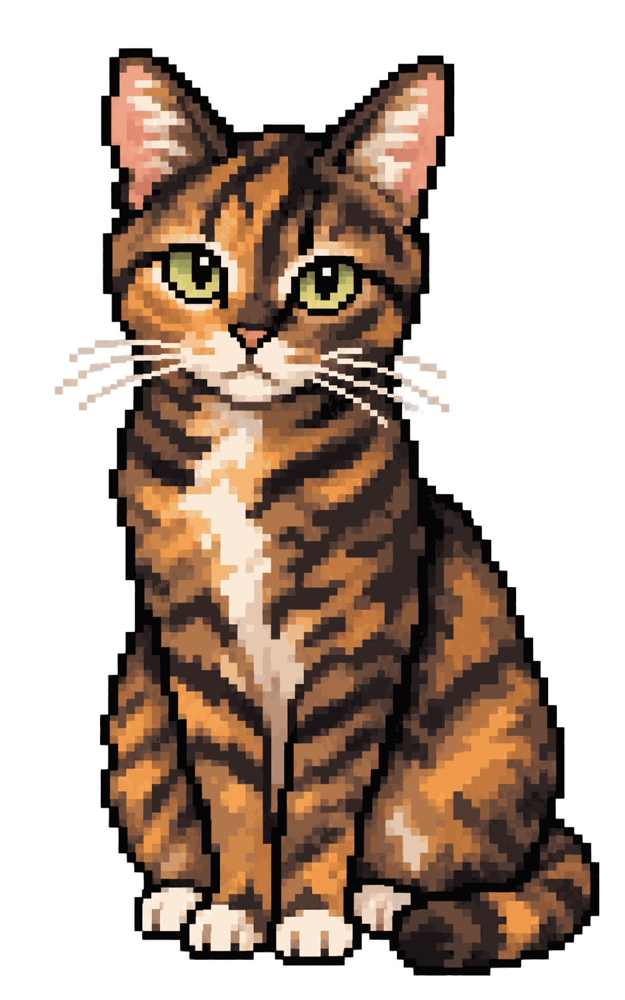

# TorTTY — Torbie TTY

<p align="center"></p>

**Fast, GPU based terminal.**

VT terminal with pty, written in Rust: its own VT parser, its own grid and
instanced drawing on the GPU (`wgpu`). It is the experiment behind the question
"does rewriting tortty-python (Python/GTK) in Rust solve distribution and performance?"
— the progress, the numbers and the decisions are in
[`TASK-tortty-in-rust.md`](TASK-tortty-in-rust.md).

Status: **migration complete** (2026-11-02). The feasibility experiment closed
at 8–9.5x Python in throughput ([`docs/BENCHMARKS.md`](docs/BENCHMARKS.md)) and
the decision was to migrate; the panel of
[`docs/MIGRATION.md`](docs/MIGRATION.md) closed at **195 of 195** parity lines.
It is here, working: VT parser, grid, pty, GPU (Vulkan, GL and CPU), keyboard
(kitty protocol included), mouse, selection/clipboard, tabs and workspaces,
kitty images, file configuration with hot reload, reflow, ligatures, emoji/CJK,
search: no. What comes now is new activity, in the queue of
[`docs/BACKLOG.md`](docs/BACKLOG.md).

## Documentation

| file | what it is for |
|---|---|
| [`docs/MIGRATION.md`](docs/MIGRATION.md) | the migration record: feature, final state, origin in Python |
| [`docs/BENCHMARKS.md`](docs/BENCHMARKS.md) | the only place with numbers (throughput, parse, drawing, footprint) |
| [`docs/CONFIG.md`](docs/CONFIG.md) | the configuration file: keys, defaults and what is an error |
| [`docs/INSTALL.md`](docs/INSTALL.md) | install, uninstall, verify and publish a binary |
| [`docs/DEBUG.md`](docs/DEBUG.md) | tools, debug socket and pitfalls — read before running the GUI |
| [`docs/PORTABILITY.md`](docs/PORTABILITY.md) | Linux/Windows/macOS: what works, what blocks, distribution |
| [`docs/LIMITATIONS.md`](docs/LIMITATIONS.md) | what is not done and why (a decision, not a queue) |
| [`docs/BACKLOG.md`](docs/BACKLOG.md) | work queue |
| [`docs/HISTORY.md`](docs/HISTORY.md) | dated record of what was done |
| [`AGENTS.md`](AGENTS.md) | conventions, architecture and tools (for agents) |
| [`TASK-tortty-in-rust.md`](TASK-tortty-in-rust.md) | dated record of phase 1 (the experiment) |

## Install

```sh
./install.sh                 # builds and installs to ~/.local/bin/tortty
./install.sh --check         # checks binary, libs and menu
./install.sh --uninstall     # removes command, entry and icon
```

tortty is a single binary (libc/libm + the GPU driver). Details, `--prefix`,
`--from-release` and coexistence with the Python bzmux (`tortty-python`):
`docs/INSTALL.md`.

## Run

```sh
cargo build --release
./target/release/tortty                          # $SHELL in 80x24
./target/release/tortty --cmd 'mc' --cols 100 --rows 30
./target/release/tortty --cmd 'vim arquivo.rs' --font-size 13
./target/release/tortty --no-vsync --debug-socket auto --prof
```

`--font-size` is in **points** (like the Python bzmux `font_size`); `--dpi`
(default 96) converts to pixels and multiplies by the monitor `scale_factor` —
it is the equivalent of GTK's `Xft.dpi`. `--debug-socket auto` opens
`$XDG_RUNTIME_DIR/tortty-<pid>.sock`.

## Quality

```sh
./tools/check.sh          # fmt + clippy (-D warnings) + tests + build + parsebench
./tools/check.sh --fix    # fixes formatting and what clippy fixes on its own
```

It also runs in `pre-commit` (`git config core.hooksPath .githooks`) and in CI.

Besides that, two gates that do not need your screen:

```sh
./target/release/tortty --selftest   # 31 checks without a window (parity with checks.py)
./tools/visual.sh                   # own Xvfb: draws, captures and compares pixels
```

## Measure

```sh
cargo run --release -p tortty-core --bin parsebench        # parser alone
./tools/bench.sh                                          # Rust x Python ladder
./tools/benchrun.py --frames 1200                         # one doom-fire measurement
```

The generator is tortty-python's `tools/doomfire.py`, copied unchanged, so both
terminals consume exactly the same bytes.

## Dev tools (PID file, never `pkill`)

```sh
./tools/devrun.sh --cmd 'mc' --debug-socket /tmp/tt.sock   # starts in background
./tools/devkill.sh                                          # kills THAT PID only
```

`pkill -f tortty` kills the shell that called it (the pattern is in its command
line); `pkill -x` was worse while the binary and the Python app shared the name
`bzmux` — it brought down a session. It has happened; that is why here you only
kill a registered PID, checking `/proc/<pid>/exe`.

## Structure

```
crates/core/     pure emulation, no GUI/pty/GPU (testable without display)
  src/{cell,color,grid,charset,term}.rs
  src/bin/parsebench.rs    parser benchmark: doomfire and file (dmesg)
crates/app/      app
  src/{main,cli,app,pty,keys,glyph,atlas,render,debugsock,prof}.rs
  src/shader.wgsl          one pipeline for background, glyph, underline and cursor
tools/{doomfire,benchrun}.py, bench.sh, devrun.sh, devkill.sh
```

The rule inherited from the Python project: `tortty-core` knows no window, pty or
GPU. That is why `cargo test -p tortty-core` runs without a display and
`parsebench` measures the parser, not the toolkit.

## Today's numbers (see the TASK)

- parser: 0.18–0.20 µs/cell on the doom-fire frame (Python post-P20: 5.49).
- `dmesg` (1397 lines, 100x40): 2.1 ms without colour / 2.2 ms with colour
  (Python: 42.6 / 78.6 ms).
- end to end, 61x18, 1200 frames, same display: 917–968 fps / 39–42 MB/s
  against 113–121 fps / 4.9–5.2 MB/s for Python.
